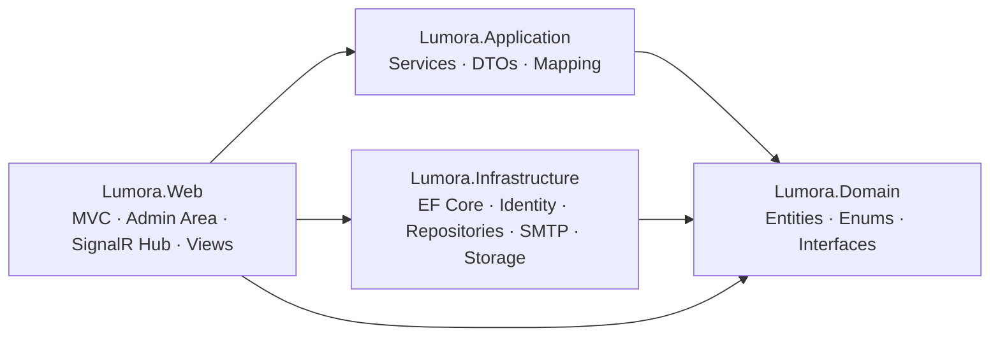

# Lumora — Student Services Platform

A multilingual web platform that helps international students find universities, housing and support in Turkey. Students can browse and filter universities, explore student housing, save favorites, request consultations and chat live with the support team. Staff manage everything from a full admin dashboard.

> Built with **ASP.NET Core MVC (.NET 9)**, **EF Core 9 + SQL Server**, **ASP.NET Core Identity** and **SignalR**, structured with **Clean Architecture**.

## Features

**Public site**
- University directory with server-side filtering (public/private, city, max tuition), search across all languages, sorting and pagination
- Student housing listings with filters and image galleries
- University / housing details pages with multi-image galleries
- Consultation request form, FAQs, services and about pages, student testimonials
- 5 languages with automatic RTL: English (default), Arabic, Turkish, Turkmen, Persian

**Student account** (self-registration, `Student` role)
- Favorites (toggle from cards, AJAX)
- Consultation requests
- Live chat with the support team (SignalR)
- Profile and change password, welcome email on sign-up

**Admin dashboard** (`/Admin`)
- CRUD for universities, housing, cities, academic programs, FAQs and testimonials, with a **5-language tabbed form** for every translatable entity
- Multi-image gallery upload for universities and housing
- Consultation requests, students and live-chat inbox (unread counters)
- Admin account management (SuperAdmin only): create / deactivate admins

## Tech Stack

| Area | Technology |
|---|---|
| Framework | ASP.NET Core MVC, Razor Views, Areas — **.NET 9** |
| Data | Entity Framework Core 9 (Code-First migrations), SQL Server |
| Auth | ASP.NET Core Identity (int keys), cookie auth, roles + policy-based authorization |
| Real-time | SignalR (JS client 8.0.7, served locally) |
| Localization | `IStringLocalizer` + `.resx` (en, ar, tr, tk, fa), cookie / query-string / `Accept-Language` providers |
| Frontend | Bootstrap 5.3 (RTL build for ar/fa), jQuery 3.7, jQuery Validation, vanilla JS — **no Node.js required** |
| Bundling | WebOptimizer (`LigerShark.WebOptimizer.Core`) — raw files in Development, bundled + minified otherwise |
| Email | `System.Net.Mail` SMTP sender (skips silently if not configured) |
| File storage | Local disk (`wwwroot/uploads`) behind `IFileStorageService` |

## Architecture

Clean Architecture with four projects. Dependencies point inward; the Web project is the composition root.



| Project | Responsibility |
|---|---|
| `Lumora.Domain` | Entities, enums, constants, repository/service **interfaces**, query objects (`PagedResult`, `*QueryParameters`). No external dependencies. |
| `Lumora.Application` | Business services (`UniversityService`, `HousingService`, `ChatService`, …), DTOs, entity↔DTO mapping. References Domain only — it never sees EF Core. |
| `Lumora.Infrastructure` | `ApplicationDbContext`, EF configurations and migrations, repositories + `UnitOfWork`, Identity (`ApplicationUser`, seeders), SMTP email, local file storage. |
| `Lumora.Web` | Controllers, Admin area, SignalR `ChatHub`, Razor views, view components, localization resources, static assets, DI composition. |

### Key design decisions

- **Translations as separate tables.** Every translatable entity (`University`, `Housing`, `City`, `AcademicProgram`, `Faq`, `Testimonial`) has a `*Translation` table with a unique index on `(EntityId, LanguageCode)`. Reads use `GetTranslationWithFallback(lang)` and fall back to English.
- **Filtering and paging happen in SQL.** Specialized repositories (`IUniversityRepository.SearchAsync`, …) take query-parameter objects and return `PagedResult<T>`.
- **Soft delete** via `IsDeleted` on all entities; the generic repository filters deleted rows automatically.
- **Domain is Identity-agnostic.** `Favorite` and `ConsultationRequest` store `StudentUserId` as a plain `int`; the foreign key to `ApplicationUser` is configured in Infrastructure.
- **Repository + Unit of Work** pattern over EF Core.
- **Policy-based authorization:** `AdminAccess` (SuperAdmin + Admin) and `SuperAdminOnly`. Public registration only ever creates `Student` accounts; admins are created from inside the panel.
- **Frontend conventions:** no inline CSS/JS in views — one CSS/JS file per page under `wwwroot/css/pages` and `wwwroot/js/pages`; shared theme tokens (`--lum-*`) in `lumora-theme.css`; CSS logical properties instead of separate RTL stylesheets.

## Project Structure

```text
.
├── Lumora/
│   └── Lumora.sln
└── src/
    ├── Lumora.Domain/            # Entities, Enums, Constants, Interfaces, Common
    ├── Lumora.Application/       # Services, DTOs, Mapping
    ├── Lumora.Infrastructure/    # Data (DbContext, Configurations, Migrations),
    │                             # Repositories, Identity, Email, Storage
    ├── Lumora.Web/               # Controllers, Areas/Admin, Hubs, Views,
    │                             # ViewComponents, Resources (.resx), wwwroot
    └── docs/                     # Phase-by-phase development notes (Arabic)
```

## Data Model

Business tables (plus the standard Identity tables):

`Cities`, `Universities`, `AcademicPrograms`, `Housings`, `Faqs`, `Testimonials` (each with a `*Translations` table) · `UniversityImages`, `HousingImages` · `Favorites` · `ConsultationRequests` · `ChatConversations`, `ChatMessages`

## Roles & Access

| Role | Access |
|---|---|
| Visitor | Browse universities, housing, FAQs, services, about |
| `Student` | Everything above + favorites, consultation requests, live chat, profile |
| `Admin` | Admin dashboard (content, consultations, students, chat inbox) |
| `SuperAdmin` | Everything above + manage admin accounts |

## Getting Started

### Prerequisites

- [.NET SDK 9.0+](https://dotnet.microsoft.com/download)
- SQL Server (LocalDB, Express or full instance)
- EF Core CLI: `dotnet tool install --global dotnet-ef`

### 1. Clone

```bash
git clone https://github.com/mohamed-alkasem/Lumora_Project_Student_Services.git
cd Lumora_Project_Student_Services/src/Lumora.Web
```

### 2. Configure (environment variables)

Set your own connection string and the first SuperAdmin account. Environment variables override `appsettings*.json`.

**PowerShell**
```powershell
$env:ConnectionStrings__DefaultConnection = "Server=(localdb)\mssqllocaldb;Database=LumoraDb;Trusted_Connection=True;MultipleActiveResultSets=true"
$env:SeedAdmin__Email    = "admin@lumora.local"
$env:SeedAdmin__Password = "ChangeMe@12345"
```

**Bash**
```bash
export ConnectionStrings__DefaultConnection="Server=localhost;Database=LumoraDb;User Id=sa;Password=<your-password>;TrustServerCertificate=True;MultipleActiveResultSets=true"
export SeedAdmin__Email="admin@lumora.local"
export SeedAdmin__Password="ChangeMe@12345"
```

### 3. Create the database

The app does **not** apply migrations on startup — run them once:

```bash
dotnet ef database update --project ../Lumora.Infrastructure --startup-project .
```

### 4. Run

```bash
dotnet run
```

| URL | Purpose |
|---|---|
| `http://localhost:5083` / `https://localhost:7069` | Public site |
| `/Admin` | Admin dashboard (log in with the `SeedAdmin` credentials) |

On startup the app seeds the roles and the SuperAdmin (when `SeedAdmin` is configured). In **Development** it also seeds sample universities, cities, programs, housing, FAQs and testimonials (only when those tables are empty).

### Optional: welcome emails

Set the `Smtp` section (e.g. a Gmail App Password). When `Host` or `Password` is empty, emails are skipped and a log line is written — nothing breaks.

```bash
export Smtp__Host="smtp.gmail.com"
export Smtp__Port="587"
export Smtp__User="you@gmail.com"
export Smtp__Password="<app-password>"
export Smtp__From="you@gmail.com"
```

### Adding a migration

Always run from `src/Lumora.Web`:

```bash
dotnet ef migrations add <Name> --project ../Lumora.Infrastructure --startup-project . --output-dir Data/Migrations
dotnet ef database update --project ../Lumora.Infrastructure --startup-project .
```

### Testing the production bundling locally

`dotnet run` forces the Development profile from `launchSettings.json`. To test minified bundles:

```bash
export ASPNETCORE_ENVIRONMENT=Production
dotnet run --no-launch-profile
```

## Localization

- Supported cultures: `en` (default / fallback), `ar`, `tr`, `tk`, `fa` — `ar` and `fa` render RTL.
- UI strings live in `Lumora.Web/Resources/SharedResources.*.resx`; translatable content lives in the `*Translations` tables.
- The language is stored in the `AspNetCore.Culture` cookie; `?culture=ar&ui-culture=ar` works for quick testing.
- Gotcha: `SharedResources.cs` must stay in the root `Lumora.Web` namespace and `AddLocalization()` must be called **without** `ResourcesPath`, otherwise lookups silently return raw keys.

## Security Notes

- Anti-forgery validation on every POST action
- Login lockout on repeated failures; deactivated accounts are rejected with the generic error message
- Open-redirect protection on `returnUrl` (`Url.IsLocalUrl`)
- Uploads: extension allow-list, 2 MB limit, GUID file names, deletion restricted to `wwwroot/uploads`
- SignalR hub requires authentication; students can only join and write to their own conversation

## Roadmap / Known Limitations

- [ ] Automated tests (unit + integration)
- [ ] Docker setup and CI pipeline
- [ ] "Forgot password" flow (requires configured SMTP)
- [ ] Pagination for all admin lists (currently Universities and Consultations)
- [ ] Granular admin permissions (sub-admins currently have full panel access)
- [ ] Cloud/object storage for uploads (currently local disk)

## Author

**Mohamad Alkassem** — [@mohamed-alkasem](https://github.com/mohamed-alkasem)
